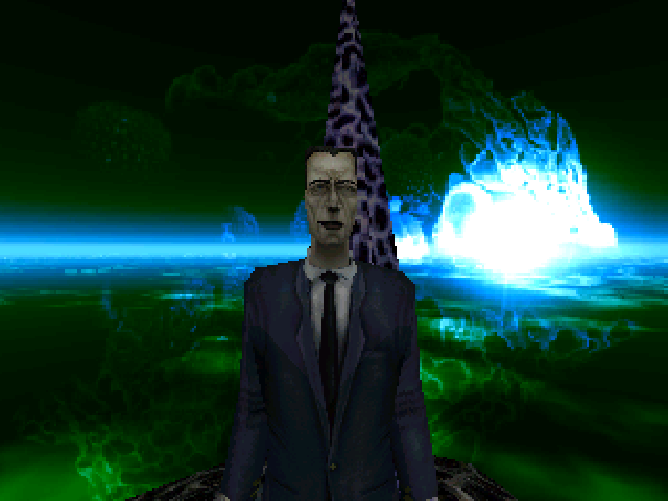

# Half-Life for R36HD

**Half-Life for the R36HD handheld (TreeFrogUI), running as a native libretro core.**

Built from Xash3D FWGS and hlsdk-portable with a software renderer tuned for the device's single MIPS 74K core and its small memory. The source code is in this repository and the build is on the [Releases](../../releases) page.

## How to play
1. Download `halflife-r36hd-1.1.0.zip` from the [Releases](../../releases) page and unzip it onto the root of the console's SD card.
2. Copy **your own** Half-Life `valve` folder into `roms/ports/halflife/valve/`. It must be the pre-25th Anniversary version (Steam beta `steam_legacy`).
3. Start **Half-Life** from the **Ports** list.

Nothing else to install. Your game files are never modified. Saves are kept in `roms/ports/halflife/valve/save/`.

Step-by-step guide, including where every file goes: [INSTALL.md](INSTALL.md).

## Highlights
- The full Half-Life campaign, with sound, music, saves and quick save and load
- Menus, console and loading screens at 640x480 so the text can be read, the game itself at 256x192
- Frames go straight to the display hardware, which scales them to the screen
- An on-screen FPS counter that can be turned off
- 35 to 58 frames per second in most rooms and about 25 in the busiest scenes, using about 18 MB of RAM
- Uses the console's idle video memory as extra heap, large TLB pages, a faster memset and the SD card at 50 MHz (see Speed helpers)

## Controls
| Button | In game | In menus |
|---|---|---|
| D-pad | move and strafe | move |
| Y / A | turn left / right | Y: tab, A: select |
| X / B | look up / down | X: backspace, B: back |
| Right stick | same as Y/A/X/B | |
| R1 | fire | page down |
| L1 | jump | page up |
| R2 | use | |
| L2 | duck | |
| START | menu | back |
| SELECT + L1 | secondary fire | |
| SELECT + Up / Down | previous / next weapon | |
| SELECT + Left | reload | |
| SELECT + Right | flashlight | |
| SELECT + X | quick save | |
| SELECT + Y | quick load | |

Turning starts slow for aiming and speeds up while the button is held.

## Options
In the picoarch menu, under core options:

| Option | Values | Default |
|---|---|---|
| Render resolution (restart) | 256x192, 320x240, 400x300 | 256x192 |
| At start (restart) | continue, newgame, menu | continue |
| FPS counter | on, off | on |

`continue` loads your newest save, and starts a new game when there is none.

## Speed helpers
The folder `roms/ports/halflife/tweaks/` holds small helpers that `run.sh` starts before the game. Their source is in `tweaks/` and `common/` of this repository and `tools/build_tweaks.sh` builds them.

| File | What it does |
|---|---|
| `prepare.sh` | clears stale TLB entries, sets the SD clock, a bigger read-ahead and a few memory settings, all lost at the next reboot |
| `tlbclear` | removes wired TLB entries a crashed game may have left behind |
| `sdfast` | SD card at 50 MHz instead of 20 MHz, with a 2 MB write and read-back check that goes back to 20 MHz on any difference |
| `libr36mem.so` | faster memset and memcpy, loaded with `LD_PRELOAD` |

The game itself uses the video memory pool as its heap and wires large TLB pages over it (`common/mmz_heap.c`, `common/bigtlb.c`). Switches are empty files in `roms/ports/halflife/`: `tweaks_off` skips every helper, `sdfast_off` leaves the SD clock alone, `bigtlb_off` turns the large pages off, `fastmem_off` keeps the stock memset. `/mnt/sdcard/cubegm/mmz_off` turns the memory pool off.

Shut the console down from the menu and do not pull the card while a game runs: that is how an SD card's file system gets damaged. If Half-Life will not start afterwards, move `valve/save` out of the way.

## Known issues
- The busiest scenes run at about 25 frames per second.
- The 25th Anniversary game files do not work: they have no `valve/skill.cfg` and the monsters break. Use the `steam_legacy` beta.
- If the screen stays black, create an empty file named `direct_off.txt` in `roms/ports/halflife/` and start again. This sends the frames through picoarch the old way.

## Notes
- You must supply your own, legally obtained copy of Half-Life. No game files are included.
- Requires an R36HD running TreeFrogUI. About 400 MB of free space is needed for the game files.
- Build instructions: [BUILDING.md](BUILDING.md).

## Credits and licences
- [Xash3D FWGS](https://github.com/FWGS/xash3d-fwgs) by Uncle Mike and the FWGS team, GPL-3.0.
- [hlsdk-portable](https://github.com/FWGS/hlsdk-portable), based on the Half-Life SDK by Valve, under the Half-Life 1 SDK licence (`LICENSE.hlsdk`).
- The libretro API header by the libretro team (MIT).
- TreeFrogUI and picoarch for the R36HD.

This port is released under the GPL-3.0 (`LICENSE`). Half-Life is a trademark of Valve Corporation. This project is not affiliated with or endorsed by Valve.
